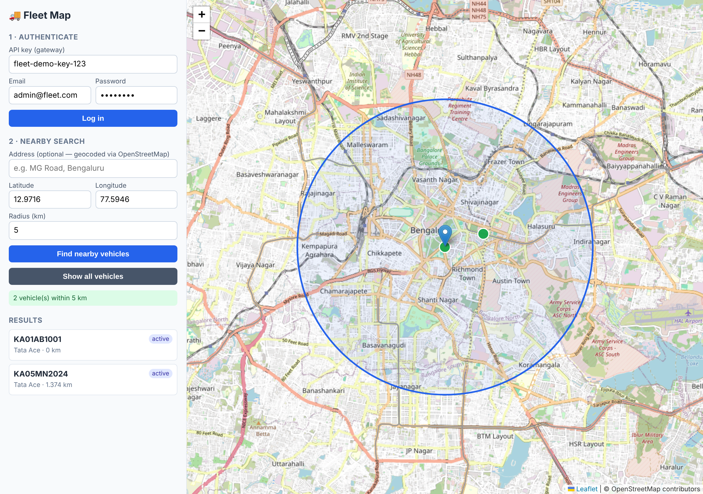

# Fleet Management System: Part 2

**Live demo:** https://fleet-management-system-5ssz.onrender.com · **API docs:** https://fleet-management-system-5ssz.onrender.com/docs

Third-party integrations (geolocation and SMS), an Express **API Gateway**, **Swagger/OpenAPI** docs and a **Mocha/Chai** test suite for a fleet management backend.

## Architecture

```
                         ┌──────────────────────────── API Gateway :3000 ───────────────────────────┐
 client ── x-api-key ──▶ │ request-id → API-key check → rate limiter → JSON validation → proxy      │
                         └──┬──────────────┬───────────────┬────────────────┬──────────────────┬─────┘
            /api/users/*    │ /api/vehicles/*  /api/telemetry/* │ /api/maps/*    │ /api/notifications/*
                    ┌───────▼─────┐ ┌──────▼──────┐ ┌───────▼───────┐ ┌──────▼──────┐ ┌─────────▼─────────┐
                    │ User :4001  │ │ Vehicle:4002│ │ Telemetry:4003│ │ Geo :4004   │ │ Notification :4005│
                    │ JWT, RBAC   │ │ CRUD,status │ │ GPS + sensors │ │ OSM/Google  │ │ Twilio / SMS stub │
                    └─────────────┘ └─────────────┘ └───────────────┘ └─────────────┘ └───────────────────┘
                                         shared data store (in-memory, or JSON file via DB_FILE)
```

| Gateway route          | Target service        | Port |
|------------------------|-----------------------|------|
| `/api/users/*`         | User Service          | 4001 |
| `/api/vehicles/*`      | Vehicle/Fleet Service | 4002 |
| `/api/telemetry/*`     | Telemetry Service     | 4003 |
| `/api/maps/*`          | Geolocation Service   | 4004 |
| `/api/notifications/*` | Notification Service  | 4005 |

Each service is its own Express app on its own port. The gateway forwards requests over HTTP, so every hop is real.

## Quick start

```bash
npm install
npm start                       # live OpenStreetMap geocoding
# or
npm run dev                     # offline mock geocoder (GEO_PROVIDER=mock)
```

* Home: http://localhost:3000/
* Swagger UI: http://localhost:3000/docs (raw spec at `/openapi.json`)
* Screenshots: http://localhost:3000/screenshots
* Map UI: http://localhost:3000/map.html (Leaflet + OpenStreetMap tiles)
* Gateway health: http://localhost:3000/health and `/health/services`

**Demo credentials**

| | |
|---|---|
| API keys | `fleet-demo-key-123`, `fleet-admin-key-456` |
| admin | `admin@fleet.com` / `admin123` |
| fleet_manager | `manager@fleet.com` / `manager123` |
| driver | `driver@fleet.com` / `driver123` |

### Try it with curl

```bash
K=fleet-demo-key-123
TOKEN=$(curl -s -X POST localhost:3000/api/users/login -H "x-api-key: $K" -H 'Content-Type: application/json' \
  -d '{"email":"admin@fleet.com","password":"admin123"}' | node -pe 'JSON.parse(require("fs").readFileSync(0)).token')

# register a vehicle by address (it gets geocoded)
curl -X POST localhost:3000/api/vehicles -H "x-api-key: $K" -H "Authorization: Bearer $TOKEN" -H 'Content-Type: application/json' \
  -d '{"vin":"1HGCM82633A004352","plateNumber":"KA05MN2024","make":"Tata","model":"Ace","address":"MG Road, Bengaluru"}'

# vehicles within 5 km
curl "localhost:3000/api/maps/nearby?lat=12.9716&lng=77.5946&radius=5" -H "x-api-key: $K" -H "Authorization: Bearer $TOKEN"

# critical event → SMS to admins
curl -X POST localhost:3000/api/telemetry -H "x-api-key: $K" -H "Authorization: Bearer $TOKEN" -H 'Content-Type: application/json' \
  -d '{"vehicleId":"<id>","latitude":12.97,"longitude":77.59,"event":"engine_fault"}'

# notification log
curl localhost:3000/api/notifications -H "x-api-key: $K" -H "Authorization: Bearer $TOKEN"
```

## Deployment (Render)

The whole system runs as one Render web service from `render.yaml`: the gateway, all 5 services, Swagger UI, the map and the screenshots gallery.

[](https://render.com/deploy?repo=https://github.com/harsh-kumar-patwa/Fleet-Management-System)

1. Sign in to [render.com](https://render.com) with GitHub, then click the button above (or go to **New → Blueprint** and pick this repo).
2. Render reads `render.yaml`, installs dependencies, runs `node src/index.js` and generates a random `JWT_SECRET`.
3. Open `https://<your-service>.onrender.com`:

| Path | What |
|---|---|
| `/` | Landing page with links and demo credentials |
| `/docs` | Swagger UI |
| `/map.html` | Map: vehicle locations and nearby search |
| `/screenshots` | Deliverable screenshots |
| `/health/services` | Health of all services |
| `/api/...` | REST API (needs `x-api-key`) |

Notes:
* The free plan sleeps after 15 minutes idle, so the first request takes about 30 s.
* Data is in memory and resets to the seed data on every restart.
* SMS uses the stub unless you add `TWILIO_*` env vars in the Render dashboard.

A `Dockerfile` is included for any Docker host. CI (`.github/workflows/ci.yml`) runs the test suite on Node 20, 22 and 24 on every push.

**Deployed URL:** https://fleet-management-system-5ssz.onrender.com

* Home: https://fleet-management-system-5ssz.onrender.com/
* Swagger UI: https://fleet-management-system-5ssz.onrender.com/docs
* Map: https://fleet-management-system-5ssz.onrender.com/map.html
* Screenshots: https://fleet-management-system-5ssz.onrender.com/screenshots
* Service health: https://fleet-management-system-5ssz.onrender.com/health/services

## Features

### 1a. Geolocation (`src/services/geo`)
* **Providers:** OpenStreetMap Nominatim (default, no key needed), Google Maps Geocoding (set `GOOGLE_MAPS_API_KEY`), and an offline `mock`. Providers can be swapped at runtime with `geo.setProvider()`, which is how the tests mock the service.
* **Address to coordinates:** `GET /api/maps/geocode`. A vehicle registered with only an `address` is geocoded automatically.
* **GPS storage:** `POST /api/telemetry` saves each reading and updates the vehicle's last known `latitude`/`longitude`.
* **Radius search:** `GET /api/maps/nearby?lat&lng&radius` or `?address=&radius=`. Distances use the Haversine formula and results are sorted nearest first.
* **Map UI:** `public/map.html` shows every vehicle and highlights the vehicles inside the search circle. Click the map to set the search centre.

### 1b. SMS notifications (`src/services/notification`)
* **Critical events:** `engine_fault`, `low_battery`, `emergency_stop`, `collision`, `overheat` and `low_fuel` all send an SMS to every **admin**. These are also detected from sensor thresholds: battery < 15% or engine temperature > 120 °C.
* **Status changes:** `PATCH /api/vehicles/{id}/status` sends an SMS to admins, fleet managers and the assigned driver.
* **Delivery records:** every SMS is saved with `status` (`sent`/`failed`), `attempts`, `providerMessageId` and `error`. You can browse them at `GET /api/notifications` and `/stats`, and resend a failed one with `POST /api/notifications/{id}/retry`.
* **Providers:**
  * **sms-stub** (default): rejects numbers that aren't in E.164 format. Numbers ending in `0000` always fail, so you can test the failure path.
  * **Twilio:** used automatically when `TWILIO_ACCOUNT_SID`, `TWILIO_AUTH_TOKEN` and optionally `TWILIO_FROM_NUMBER` are set. Sandbox or test credentials work.

### 2. API Gateway (`src/gateway`)
* **API key:** sent in the `x-api-key` header. A missing key returns `401` and an invalid key returns `403`. The key is removed before the request is forwarded.
* **Rate limiting:** fixed window per API key (default `RATE_LIMIT_MAX=100` per `RATE_LIMIT_WINDOW_MS=60000`). Responses carry `X-RateLimit-*` headers. Requests over the limit get `429` with `Retry-After`.
* **Forwarding:** method, headers, body and status are passed through in both directions. The gateway adds `X-Request-Id`, `X-Forwarded-For` and `X-Upstream-Service`.
* **Errors:**
  * Unmapped route: `404`
  * Malformed JSON: `400`
  * Service down: `503`
  * Upstream timeout: `504`

### 3. Swagger / OpenAPI (`src/docs/openapi.js`)
OpenAPI 3.0 spec served by Swagger UI at `/docs`. It includes:
* request and response schemas for every endpoint
* both security schemes (API key and JWT bearer)
* the roles each endpoint requires
* example requests and responses
* error responses (400/401/403/404/409/429/502/503)

### 4. Tests (`test/`)

```bash
npm install
npm test          # 47 tests, about 6 s, no network needed
```

| File | Flow |
|---|---|
| `01-auth.test.js` | User login and JWT verification (valid, tampered and expired tokens) |
| `02-vehicles.test.js` | Vehicle registration and retrieval, including geocoding by address |
| `03-telemetry.test.js` | Telemetry submission and storage, and critical-event SMS |
| `04-status-notifications.test.js` | Status update triggers SMS; failed deliveries and retry |
| `05-rbac.test.js` | RBAC: a driver or manager trying to delete a vehicle gets 403 |
| `06-nearby.test.js` | Nearby search with a mocked geolocation provider |
| `07-gateway.test.js` | Gateway: routing, API key checks, rate limiting, 400/404/503 errors |

All **7** flows are covered (5 were required). The tests use a mocked geocoder and the stub SMS provider, so they never call external services.

## Configuration (env vars)

| Var | Default | Purpose |
|---|---|---|
| `PORT` | 3000 | Gateway port |
| `USER_SERVICE_PORT` … `NOTIFICATION_SERVICE_PORT` | 4001–4005 | Service ports |
| `API_KEYS` | `fleet-demo-key-123,fleet-admin-key-456` | Accepted gateway keys |
| `RATE_LIMIT_MAX` / `RATE_LIMIT_WINDOW_MS` | 100 / 60000 | Rate limit |
| `JWT_SECRET` | dev value | **Set in production** |
| `GEO_PROVIDER` | `nominatim` | `nominatim`, `google` or `mock` |
| `GOOGLE_MAPS_API_KEY` | – | Turns on the Google provider |
| `TWILIO_ACCOUNT_SID` / `TWILIO_AUTH_TOKEN` / `TWILIO_FROM_NUMBER` | – | Turns on Twilio |
| `DB_FILE` | – (in-memory) | Persist data to a JSON file, e.g. `data/db.json` |

## Screenshots

Captured from the running app with `npm run screenshots` (needs Playwright) into `docs/screenshots/`:

| | |
|---|---|
| Vehicle geolocation and nearby search (API) | `01-geolocation-nearby-api.png` |
| SMS for critical events and status changes | `02-sms-notifications.png` |
| Gateway routing, API key verification, errors | `03-gateway-routing-apikey.png` |
| Gateway rate limiting | `04-gateway-rate-limit.png` |
| Swagger UI | `05-swagger-ui.png`, `06-swagger-nearby-endpoint.png` |
| Map UI: all vehicles and nearby search | `07-map-all-vehicles.png`, `08-map-nearby-search.png` |



## Project layout

```
src/
  index.js                 boots the 5 services and the gateway
  gateway/                 app.js (routing/proxy/API key), rate-limiter.js
  services/{user,vehicle,telemetry,geo,notification}/
  shared/                  config, db, auth (JWT + RBAC), errors, seed data
  docs/openapi.js          OpenAPI 3 spec
public/map.html            Leaflet map UI
test/                      Mocha + Chai + Supertest
scripts/screenshots.js     Playwright screenshot capture
```
